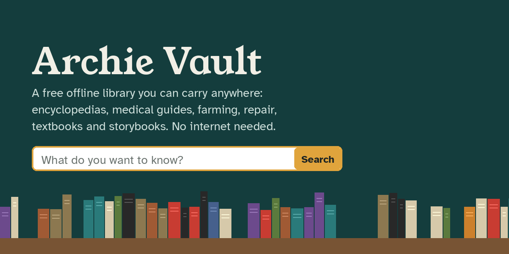
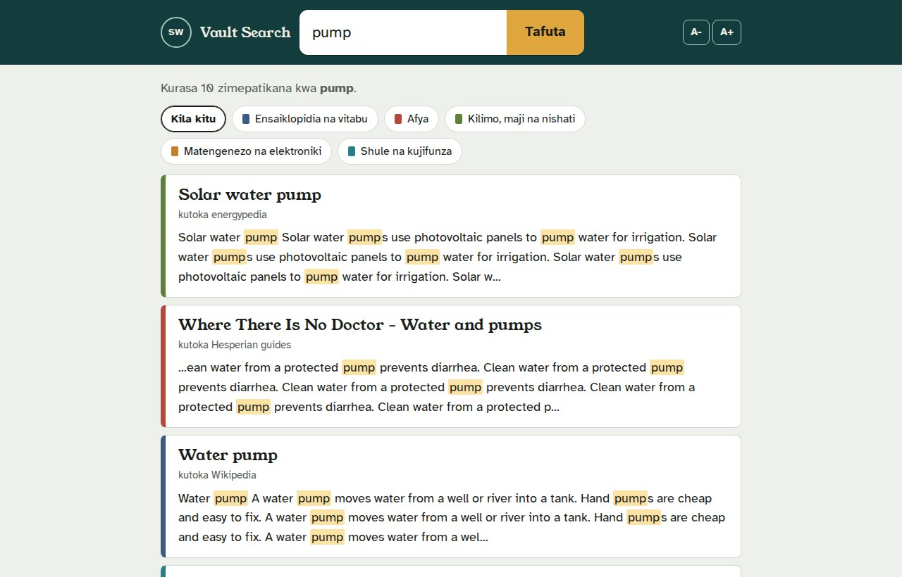
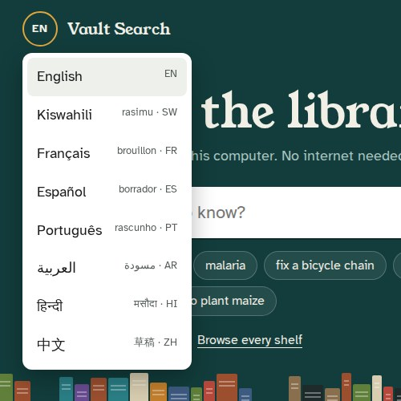

<p align="center"></p>

# Archie Vault

A free offline library you can carry anywhere: encyclopedias, medical guides, farming and water know-how, repair manuals, textbooks, storybooks, coding docs and maps, readable with no internet at all.

Archie Vault is two things:

1. **Downloaders** (one double-click file per subject) that fetch openly licensed library packs straight from their official sources, [Kiwix](https://kiwix.org) and [World Possible's RACHEL](https://worldpossible.org). This project never hosts the content itself.
2. **Vault Search**, one program you double-click. It opens a single search box in your browser, searches every pack at once, and shows the pages. No install, no internet. For browsing, it also has every pack on a subject shelf, kids / teens / adults shelves, a random page and three picks a day.

It is built for schools, clinics, community centres, farms, relief camps and anyone with a computer and a slow, costly or missing connection.

<table>
<tr>
<td width="62%"></td>
<td width="38%"></td>
</tr>
</table>

Project website: [buildbeyond1889.github.io/vault](https://buildbeyond1889.github.io/vault/)

## What it is, and what it isn't

The Vault is a very large library, and that's all it is. It can put millions of pages within reach with no connection, and help someone look things up, learn a skill or prepare. It can't examine a patient, test water, check a wiring job, know local conditions, or keep itself current: every pack is a snapshot, and some are years old. Use it alongside the people around you, and when something is urgent or dangerous, reach someone trained if you can. It's meant to help wherever it can.

## Get started (Windows)

**If someone gave you a Vault drive:** plug it in and double-click **Vault Search.exe** on it. A search page opens in your browser. That's all.

**To build your own library:**

1. Download this repository (green **Code** button, then **Download ZIP**) and unzip it onto a big drive. Download **Vault Search.exe** from the [Releases page](https://github.com/BuildBeyond1889/vault/releases) into the same folder.
2. Double-click a **Get** file below. The first time, it asks which folder to save into. Downloads resume if the internet drops: just run the same file again.
3. Double-click **Vault Search.exe**. Type what you want to know.

**Make a Vault Drive.bat** copies your library onto a USB drive or SD card, with Vault Search and the licence list, ready to hand to someone. No drive? **Make a Vault Zip.bat** packs one set into a single .zip to upload to Google Drive or OneDrive and download on another computer. (Prefer Python? **Open Vault.bat** runs the same thing from source.)

| File | What's in it | Packs | Size |
| --- | --- | --- | --- |
| `Get - Core knowledge.bat` | Wikipedia (intros edition), dictionaries, Wikibooks, Wikivoyage, Wikisource, World Factbook | 11 | 39 GB |
| `Get - Health and Medicine.bat` | MDWiki, WikEM, medical Wikipedia, NHS medicines, CDC travel health, LibreTexts medicine, WikiVet | 8 | 6 GB |
| `Get - Farming Water Energy Survival.bat` | Appropedia, energypedia, water and food guides, Ready.gov, gardening, DIY and outdoors Q&A, Infonet-Biovision | 16 | 16 GB |
| `Get - Repair and Electronics.bat` | iFixit, Electronics, Arduino, Raspberry Pi and Robotics Q&A, Linux and old-hardware wikis | 20 | 18 GB |
| `Get - Coding.bat` | Docs for ~35 languages and tools, Code Review, CS and Game Development Q&A, algorithms books, Scratch, Blockly | 49 | 4 GB |
| `Get - Learning.bat` | LibreTexts, OpenStax, CK-12, Siyavula, PhET simulations, storybooks, Nicky Case, Math and Physics Q&A, Saylor | 31 | 59 GB |
| `Get - Kids.bat` | African Storybook, Book Dash, Vikidia, Simple English Wikipedia, PhET, Scratch, Blockly | 11 | 23 GB |
| `Get - Maps.bat` | OpenStreetMap: Kenya, Tanzania, Uganda, Africa, USA | 5 | 24 GB |
| `Get - Shelters and Soup Kitchens.bat` | First aid, medicines, cooking and food storage, disasters and cold weather, job skills, English, phones, easy reading (US) | 15 | 8 GB |
| `Get - Pocket Set.bat` | Small versions for a phone, SD card or old computer | 18 | 31 GB |
| `Get - Everything Shareable.bat` | All of the above in one go (not the big libraries) | 140 | 165 GB |
| `Get - Big Libraries.bat` | Full Wikipedia, Khan Academy, Stack Overflow, Gutenberg, Saylor courses: asks about each | 5 | 652 GB |

Everything shareable together is about **165 GB**. **Choose Packs.bat** lets you pick packs one by one, and **Check for Updates.bat** finds newer versions.

## Licences: what you can share

Of the 181 packs listed, 124 are public domain or openly licensed, 25 are free for non-commercial use, 14 need the owner's permission before copies are handed out, and 18 have no licence anyone could find. The Get files only download the first two groups. [PACK-LICENSES.md](PACK-LICENSES.md) lists every pack, its licence and the credit it asks for.

If you give copies away:

- **Always free.** Never sell, rent or charge for the drive, the box or access, and no ads. That keeps every non-commercial pack legal.
- **Keep PACK-LICENSES.md with every copy.** It carries the credits the licences ask for.
- **Keep packs whole and unchanged.** A few licences forbid edits.
- **No logos or endorsement claims.** This project is not affiliated with Wikipedia, Kiwix, World Possible or any pack's publisher.
- **Medical packs are reference, not a doctor.** Each pack shows its version date; check with a health worker.

## Translations

Vault Search speaks English, Kiswahili, Français, Español, Português, العربية, हिन्दी and 中文. Only English was checked by a fluent speaker; the others are drafts and say so on screen. If you spot a mistake, use **Help fix this translation** on the screen, or [open a translation fix](https://github.com/BuildBeyond1889/vault/issues/new?template=translation.md). No code needed.

## How it works

- `tools/get-vault.ps1` reads `tools/packs.csv`, asks the [Kiwix catalog](https://library.kiwix.org) for the newest version of each pack, and downloads with `curl` (resumable). RACHEL modules come from rachel.worldpossible.org.
- `Vault Search.exe` is `tools/vault_app.py` packaged with Python by PyInstaller; GitHub builds it on every release (`.github/workflows/build-exe.yml`). It looks for a `zim` folder next to itself first, so a drive with the program on it just works.
- `tools/vault_app.py` runs two small web servers on `127.0.0.1` only: the search and shelves (port 8780) and the pack pages (port 8781). Pages from packs are kept on their own port so they can never reach the Vault's controls.
- `tools/vault.py` reads `.zim` files with [libzim](https://pypi.org/project/libzim/), builds the catalogue, and searches titles first, then full text.
- Nothing is sent anywhere. The Vault keeps its own notes (saved pages, what you've seen) in `data/`.

Requirements: Windows 10 or 11 (Python only if you run from source), and space: about 31 GB for the pocket set, 165 GB for everything shareable, and up to 652 GB more for the big libraries.

## Tests

```
pip install pytest
pytest
```

The tests check the pack list (every pack has a shelf, a size and a licence verdict, and every pack is in PACK-LICENSES.md), that the Get files only download packs that are legal to share, that every Get file names a real set, that each translation has every word the English screen has, and that the program compiles. GitHub runs them on every push.

## Status

Early and working. Built and tested on one Windows PC. Next: Mac and Linux scripts, and a Raspberry Pi "Vault Box" that shares the library over its own Wi-Fi to any phone nearby.

## Credits

The library content belongs to its creators: thousands of Wikipedia, Stack Exchange, OpenStreetMap and wiki contributors, and the publishers listed in [PACK-LICENSES.md](PACK-LICENSES.md). Thanks to [Kiwix](https://kiwix.org) and [World Possible](https://worldpossible.org), who package and serve these libraries for free. Fonts: Young Serif, Atkinson Hyperlegible (Braille Institute), Geist and JetBrains Mono, all under the SIL Open Font License.

Code: MIT licence, see [LICENSE](LICENSE). `Vault Search.exe` also contains [python-libzim](https://github.com/openzim/python-libzim) (GPL-3.0), so the packaged program as a whole is shared under GPL-3.0; its full source is this repository plus python-libzim. Built by BuildBeyond1889 with help from Claude (Anthropic).
